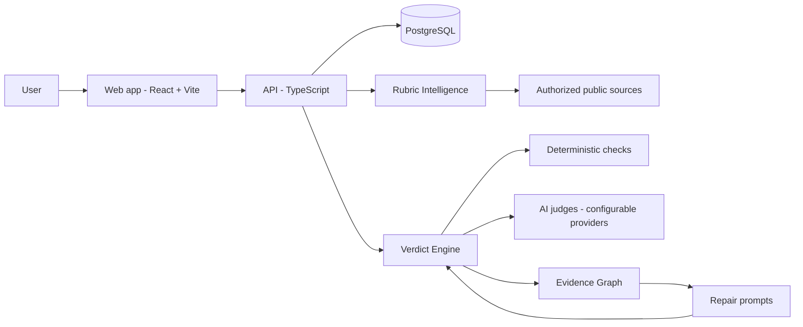

<div align="center">

# VERDICT QA

**Evidence-driven quality assurance for projects, AI outputs and competition submissions.**

*Explains **why**. Shows the **evidence**. Names **what is wrong**. Recommends **how to fix it**. Verifies **whether the fix worked**.*

Built by **MRJAYVIRTUAL Technologies**

</div>

---

## The question Verdict answers

> **"What's the competition's judging rubric?"**

Most builders submit blind. Verdict turns published requirements into a structured, versioned rubric, evaluates a submission against it with traceable evidence, and closes the loop: it generates a targeted repair prompt for every failure, then re-evaluates and compares the result.

## Project status (read this first)

This README separates **what exists** from **what is planned**. Nothing below is marked built unless it is in the repository and verified.

| Area | Status | Notes |
|---|---|---|
| pnpm monorepo (`web`, `api`, `database`, `shared-types`) | Present | Package scaffolds exist; `api`, `database` and `shared-types` source has not been audited yet |
| Vercel configuration | **Repaired** | Duplicate `env` key removed, lockfile-safe install, SPA rewrites, security headers (commit `ace1ec5`) |
| Toolchain pinning | **Repaired** | `packageManager: pnpm@9.15.0`, Node `>=20`, scripts scoped to real packages (commit `e6091bb`) |
| Web application | Stub | Entry files only; the full interface is not built yet |
| Rubric Intelligence | Planned | Specified in [`docs/RUBRIC_INTELLIGENCE.md`](docs/RUBRIC_INTELLIGENCE.md) |
| Verdict evaluation engine | Planned | Specified in [`docs/ARCHITECTURE.md`](docs/ARCHITECTURE.md) |
| Closed-loop repair and re-evaluation | Planned | |
| Authentication, persistence, analytics | Planned | |
| Automated tests | Not yet written | No test results are claimed |
| Production deployment | Pending | See [`docs/DEPLOYMENT.md`](docs/DEPLOYMENT.md) |

The full, ordered plan lives in [`docs/ROADMAP.md`](docs/ROADMAP.md).

## Product vision

Verdict evaluates whether a submission actually meets its requirements.

1. **Discover** official requirements from authorized public sources, or accept URLs, PDFs, documents and pasted rules.
2. **Structure** them into a rubric: criteria, weights, scales, required evidence, eligibility and disqualification rules.
3. **Evaluate** a submission against that rubric with deterministic checks plus AI-based qualitative judgement.
4. **Explain** every score with linked evidence, confidence and uncertainty.
5. **Repair** by generating a coding-agent prompt for each unmet criterion.
6. **Re-evaluate** after the fix and compare old versus new results.

### Honesty rules (non-negotiable)

- Never invent competition rules, evidence, scores or test results.
- Every fact is labelled **Verified**, **Inferred** or **Unknown**.
- Unpublished weights display **"Not specified"**, never a guess.
- If no official rubric is found, Verdict says so and asks for the rules.
- A failed AI provider call is **never** treated as a successful evaluation.
- A fix is never marked executed or verified unless it actually was.
- Official competition scores are kept separate from Verdict's internal quality scores.

## Verdict statuses

| Status | Meaning |
|---|---|
| `PASS` | All required criteria met with sufficient evidence |
| `CONDITIONAL PASS` | Required criteria met; non-critical gaps remain |
| `NEEDS REVIEW` | Insufficient evidence, judge disagreement, or provider failure |
| `FAIL` | One or more required criteria unmet, or a disqualification rule triggered |

## Differentiating features (planned)

- **Evidence Graph** linking source, criterion, evidence, test and recommended fix
- **Multi-Judge Consensus** with disagreements surfaced for human review
- **Quality Regression Gate** for code, prompt and model changes
- **Agent Repair** prompts generated from real findings
- **Competition Readiness** for hackathons, accelerators, grants and AI challenges
- **Human Review** with manual score adjustments and an audit trail
- **Rubric Versioning** with impact analysis on prior evaluations
- **Evaluation Analytics** from persisted data, not placeholder metrics
- **GitHub Integration** tying findings to files and code locations
- **Shareable Reports** with evidence, methodology and limitations

## Architecture



See [`docs/ARCHITECTURE.md`](docs/ARCHITECTURE.md) for details.

## Repository structure

```
.
├── packages/
│   ├── web/            # React + Vite frontend
│   ├── api/            # Backend API
│   ├── database/       # Schema and migrations
│   └── shared-types/   # Types shared across packages
├── docs/               # Architecture, rubric spec, roadmap, deployment, development
├── docker/             # Container configuration
├── .github/            # GitHub configuration
├── docker-compose.yml
├── pnpm-workspace.yaml
├── tsconfig.json
└── vercel.json
```

## Getting started

**Requirements:** Node.js 20+, pnpm 9+

```bash
git clone https://github.com/mrjayvirtual/Verdict-QA.git
cd Verdict-QA
pnpm install
cp .env.example .env.local
pnpm dev          # starts the web app
```

| Command | Purpose |
|---|---|
| `pnpm dev` | Run the web app in development |
| `pnpm build` | Build the web app (what Vercel runs) |
| `pnpm build:all` | Build every package that defines a build script |
| `pnpm typecheck` | Type-check every package that defines the script |
| `pnpm test` | Run unit tests (passes with no tests while none exist) |

## Environment variables

See [`.env.example`](.env.example). **No secret is ever read by frontend code.** Only variables prefixed `VITE_` reach the browser, and none of them may hold credentials.

| Variable | Scope | Purpose |
|---|---|---|
| `DATABASE_URL` | Server | PostgreSQL connection string |
| `JWT_SECRET` | Server | Session signing secret |
| `AI_PROVIDER` | Server | Which AI provider the judges use |
| `AI_API_KEY` | Server | Provider credential; if missing, Verdict reports AI evaluation as unavailable |
| `GITHUB_TOKEN` | Server | Optional; enables repository evaluation |
| `CORS_ORIGIN` | Server | Allowed web origin |
| `VITE_API_URL` | Browser | Public API base URL (no secrets) |

## Deployment

The frontend deploys to Vercel from `main` using the committed [`vercel.json`](vercel.json). Full steps, including the backend and database, are in [`docs/DEPLOYMENT.md`](docs/DEPLOYMENT.md).

## Security principles

- Strict TypeScript and runtime validation of API inputs and AI outputs
- Server-side credentials only; ownership enforced per project
- Prompt-injection defenses for uploaded and retrieved content
- Rate limiting, safe retries and audit history

These are design requirements. Items are marked built only once implemented and verified.

## Contributing

See [`CONTRIBUTING.md`](CONTRIBUTING.md). Use conventional commits and never claim a feature or test result you have not run.

## License

MIT. See [`LICENSE`](LICENSE).

---

<div align="center">

**VERDICT QA** · Built by **MRJAYVIRTUAL Technologies** · [github.com/mrjayvirtual](https://github.com/mrjayvirtual)

</div>
