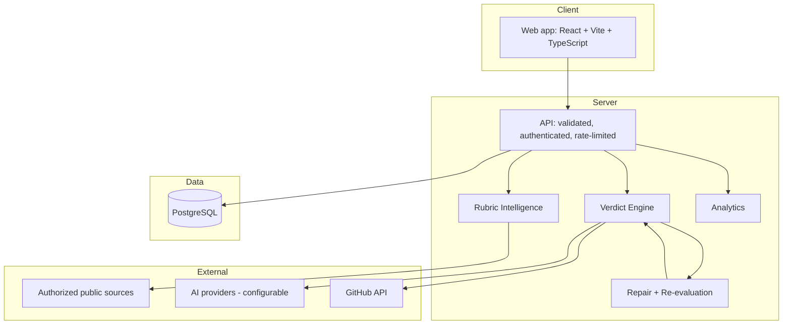

# Architecture

Design document for Verdict QA. Sections describe the **target** design; implementation status is tracked in [`ROADMAP.md`](ROADMAP.md).

## System overview



## Packages

| Package | Responsibility |
|---|---|
| `@verdict/web` | Interface: dashboard, projects, rubrics, evaluations, tests, issues, analytics, settings |
| `@verdict/api` | HTTP API, auth, validation, rate limiting, orchestration |
| `@verdict/database` | Schema and migrations |
| `@verdict/shared-types` | Types and validation schemas shared by web and api |

## Verdict Engine

Every evaluation combines two layers.

1. **Deterministic checks** - verifiable facts: required files present, build succeeds, links resolve, format and length limits met, forbidden content absent.
2. **AI qualitative judgement** - criteria that need interpretation, scored by independent judges against the rubric with required evidence quotes.

### Per-criterion output

```ts
interface CriterionResult {
  criterionId: string;
  status: 'pass' | 'fail' | 'partial' | 'needs-review';
  score: number | null;          // null when not scorable
  evidence: EvidenceRef[];       // must reference real source material
  weaknesses: string[];
  explanation: string;
  confidence: number;            // 0..1
  uncertainty: string[];
  recommendedFix?: string;
}
```

### Overall verdict

`PASS`, `CONDITIONAL PASS`, `NEEDS REVIEW` or `FAIL`, derived from criterion results, disqualification rules and judge agreement.

### Failure handling

- A provider error, timeout or schema-invalid response yields `needs-review` or an explicit error. It is **never** recorded as a successful score.
- Retries are bounded and safe (idempotent, with backoff).
- Missing credentials are reported as an unavailable capability, never simulated.

## Multi-Judge Consensus

Independent judges score the same submission against the same rubric. Verdict compares scores, computes agreement, and routes disagreements above a threshold to human review. Individual judge outputs are retained.

## Evidence Graph

Every verdict is a path of linked records:

```
Source -> Criterion -> Evidence -> Test -> Finding -> Recommended fix -> Re-evaluation
```

No verdict exists without evidence nodes. This is what makes results auditable and shareable.

## Closed loop

For every failure: identify the unmet criterion, attach evidence, explain the gap, recommend a specific fix, generate a coding-agent repair prompt, let the user apply the fix, **re-run**, and diff old versus new. Resolved issues, remaining weaknesses and regressions are tracked. A fix is marked verified only after a successful re-evaluation.

## Quality Regression Gate

Stores baseline scores per project. After a code, prompt or model change, a new run is compared to the baseline; drops beyond a configured tolerance fail the gate.

## Human review

Reviewers may adjust a score with a mandatory explanation. Original and adjusted values, author and timestamp are kept in an append-only audit log.

## Data model (core entities)

`users`, `projects`, `rubrics` (versioned), `criteria`, `submissions`, `evaluations`, `criterion_results`, `evidence`, `judge_runs`, `test_cases`, `test_executions`, `issues`, `repair_prompts`, `review_adjustments`, `audit_log`.

Project ownership is enforced on every query.

## Security

- Strict TypeScript; runtime validation of all API inputs and AI outputs
- Credentials only on the server; none in frontend bundles
- Authentication and per-project authorization
- Prompt-injection defense: retrieved and uploaded content is delimited and treated as untrusted data
- Rate limits, bounded retries, structured error handling
- Append-only audit records

## Deployment topology

| Component | Target |
|---|---|
| Web | Vercel (static build of `packages/web`) |
| API | Serverless functions or a Node host; decided and documented in [`DEPLOYMENT.md`](DEPLOYMENT.md) |
| Database | Managed PostgreSQL |
